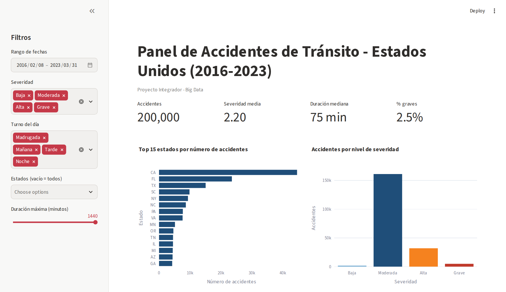
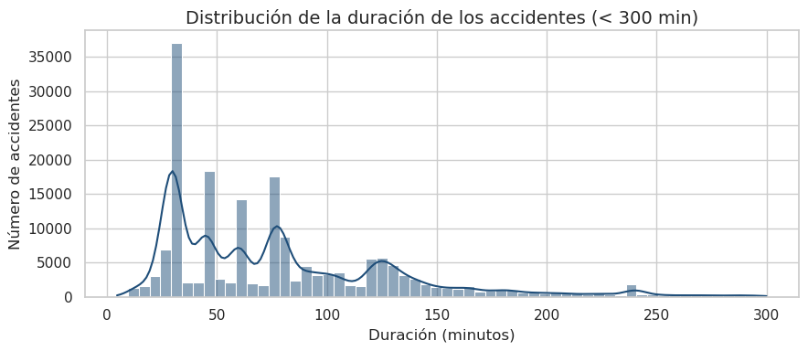
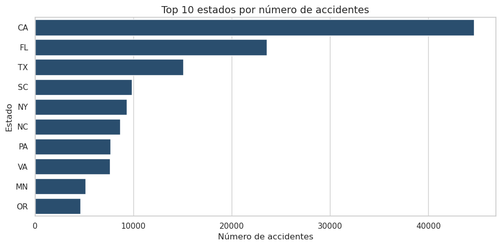
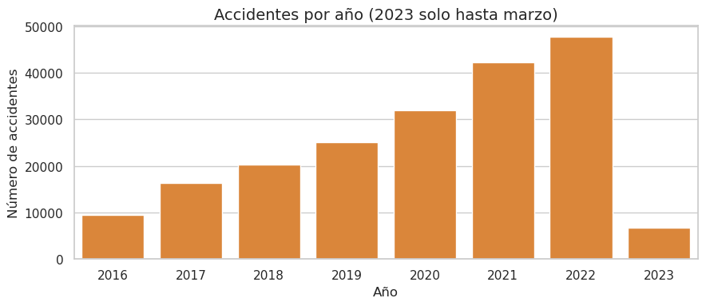
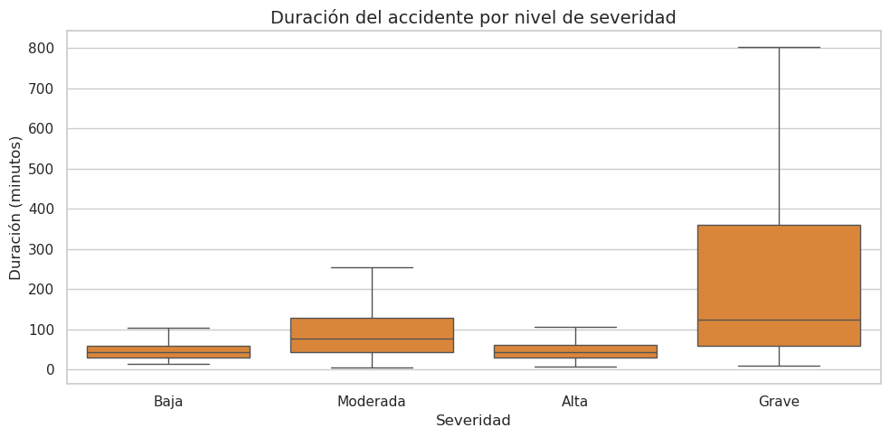
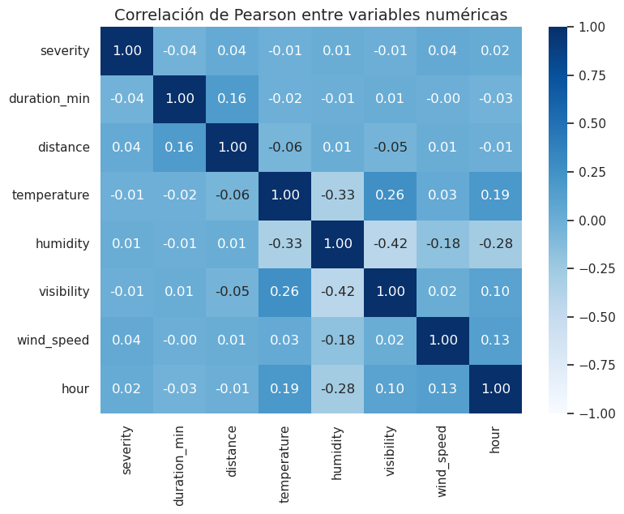
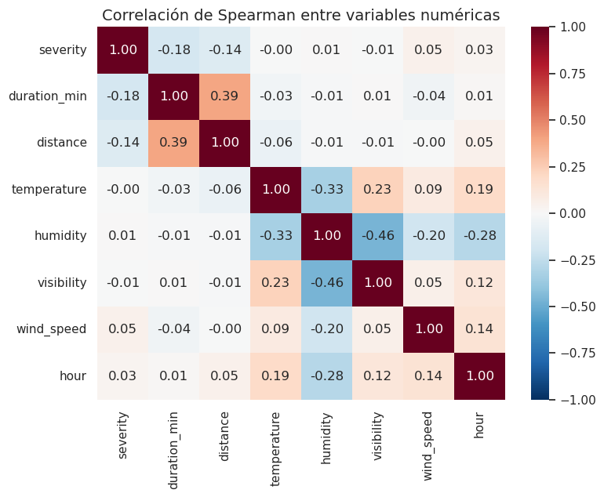
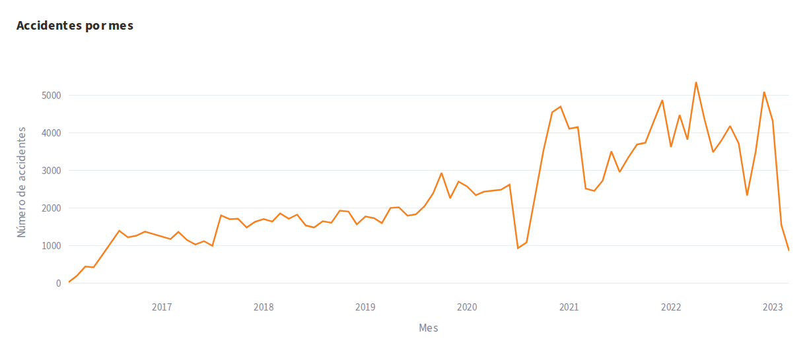
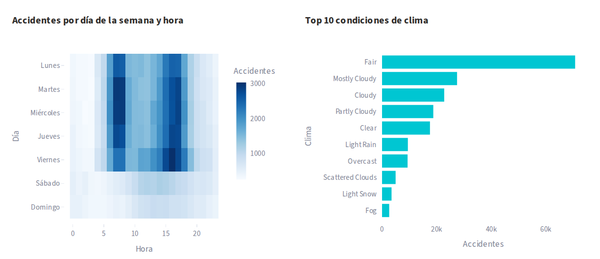
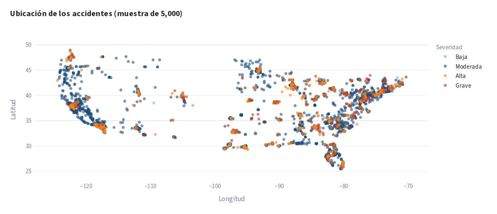

# Proyecto Integrador Big Data - Accidentes de tránsito en EE.UU.

Análisis de los accidentes de tránsito registrados en Estados Unidos entre **febrero de 2016 y marzo de 2023**: limpieza de los datos, gráficos y un dashboard interactivo en **Streamlit**.

Universidad Santo Tomás - Seccional Tunja · Ingeniería de Sistemas · Big Data 2026-2



## Contenido del repositorio

| Archivo | Qué es |
|---|---|
| `notebookIntegrador.ipynb` | Notebook con la limpieza (Avance 1) y la visualización (Avance 2), con los resultados visibles |
| `app.py` | Dashboard en Streamlit |
| `requirements.txt` | Librerías necesarias |
| `accidentes_limpios.csv` | Dataset limpio (200.000 accidentes, 16 columnas, sin nulos) |
| `barras_estados.html`, `scatter_ubicacion.html` | Gráficos interactivos de Plotly exportados |
| `graficas/` | Imágenes de los gráficos y del dashboard |

## Dataset

**US Accidents (2016 - 2023)** de Kaggle: https://www.kaggle.com/datasets/sobhanmoosavi/us-accidents

El archivo original `US_Accidents_March23.csv` pesa 3 GB (7.728.394 filas y 46 columnas), por eso **no está en el repositorio**. Para correr el notebook desde cero hay que descargarlo y ponerlo en esta misma carpeta. El dashboard **no lo necesita**: usa `accidentes_limpios.csv`, que sí está incluido.

## Cómo ejecutarlo

```bash
pip install -r requirements.txt
streamlit run app.py
```

Se abre en `http://localhost:8501`.

## 1. Limpieza de los datos

Hecha con Pandas y NumPy en el notebook:

1. Se cargan solo 14 de las 46 columnas para que el archivo quepa en memoria.
2. Se revisan los tipos de datos, los nulos y las estadísticas básicas.
3. Se renombran las columnas a nombres cortos (`severity`, `start_time`, `temperature`, ...).
4. Se convierten las fechas con `format='mixed'` (algunas traen nanosegundos) y se calcula la duración en minutos.
5. Se filtran los registros no válidos con una sola máscara: severidad de 1 a 4, duración entre 1 minuto y 1 día, distancia menor a 50 mi, sin nulos en el clima y con valores posibles.
6. Se crean columnas legibles: severidad (Baja, Moderada, Alta, Grave), día/noche y turno (Madrugada, Mañana, Tarde, Noche).
7. Se recortan los valores extremos con `np.clip`.
8. Se toma una muestra de 200.000 accidentes y se exporta a `accidentes_limpios.csv`.

| Etapa | Filas |
|---|---|
| Dataset original | 7.728.394 |
| Después del filtro | 7.032.881 |
| `accidentes_limpios.csv` | 200.000 |

## 2. Gráficos del notebook

| | |
|---|---|
|  |  |
|  |  |
|  |  |

**Hallazgos:**

- **California** tiene el 22,3% de los accidentes, seguida de Florida (11,8%) y Texas (7,5%).
- La duración está sesgada a la derecha: media de 109 min y mediana de 75 min.
- Los accidentes **graves** duran mucho más (mediana de 126 min). El 80,6% de los accidentes son de severidad moderada.
- Los registros crecen cada año, de 9.410 en 2016 a 47.722 en 2022 (en la muestra; 2023 solo llega hasta marzo).
- La correlación más alta es humedad-visibilidad (-0,42). Son asociaciones, no causalidad.

## 3. Dashboard en Streamlit

**Filtros:** rango de fechas, severidad, turno del día, estado y duración máxima.

**Indicadores:** número de accidentes, severidad media, duración mediana y porcentaje de accidentes graves.

**Gráficos:** top 15 estados, accidentes por severidad, accidentes por mes, mapa de calor por día y hora, top 10 condiciones de clima y mapa de ubicación por severidad.





**Lo que muestra:**

- Los accidentes se concentran de **lunes a viernes** en las horas pico de la mañana (7-8 a.m.) y de la tarde (3-5 p.m.).
- La serie mensual sube a partir de 2020 y tiene sus valores más altos entre 2021 y 2022.
- La mayoría de los accidentes ocurre con clima despejado (*Fair*).
- Los accidentes se concentran en las costas y en las grandes ciudades.

## Tecnologías

Python, Pandas, NumPy, Matplotlib, Seaborn, Plotly y Streamlit.
